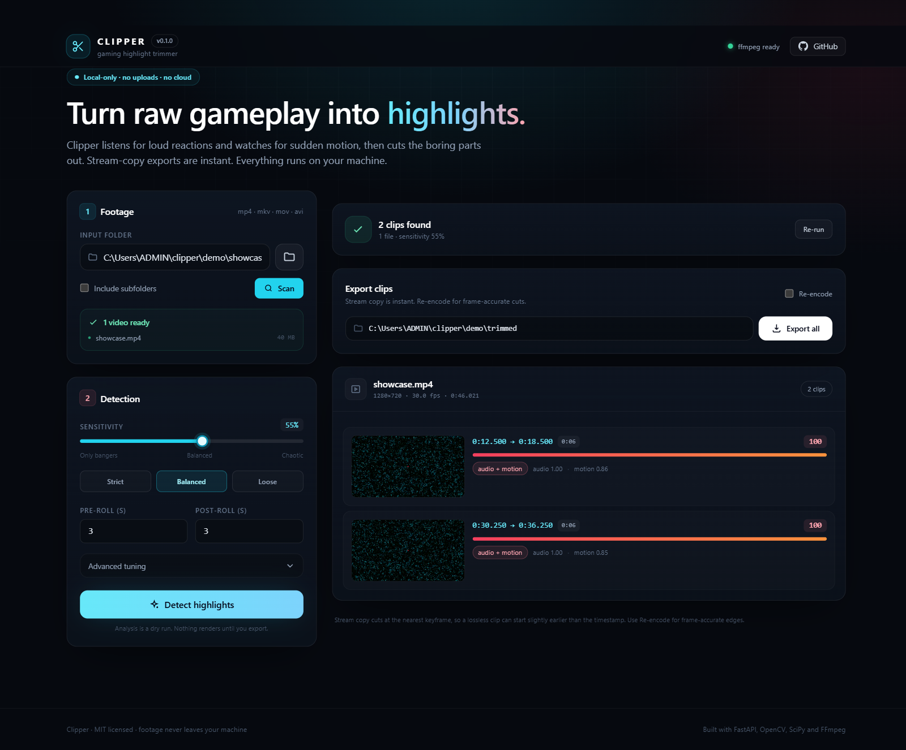

# Clipper

**Raw gameplay in. Highlights out.**

Clipper scans a folder of gameplay footage, finds the loud reactions and sudden motion, merges overlapping moments, and cuts them into ready-to-post clips with FFmpeg. It runs entirely on your machine — no uploads, no accounts, no cloud, no model downloads.

[](https://github.com/hatermedia/clipper/actions/workflows/ci.yml)
[](LICENSE)
[](https://www.python.org/)
[](#privacy)



---

## What it does

- **Batch a whole folder** of `.mp4`, `.mkv`, `.mov`, and `.avi` captures.
- **Audio spike detection** — short-time RMS, rolling loudness baseline, robust z-score. Finds gunfights, reactions, hype moments.
- **Visual motion detection** — samples a tiny proxy through OpenCV and scores frame deltas, hard cuts, and kill-feed flashes.
- **Hybrid excitement score** — blends both signals, rewards agreement, smooths the result, and adapts its threshold to each video.
- **Smart padding and merging** — 8s before / 5s after by default; overlapping windows merge so a continuous fight stays one clip.
- **Fast exports** — stream copy by default (`ffmpeg -c copy`), optional frame-accurate re-encode with `libx264`, `h264_nvenc`, `hevc_nvenc`, or `libx265`.
- **Local web UI** — FastAPI + one HTML file with Tailwind and Alpine. Folder browser, sliders, preview thumbnails, batch progress, cancel.
- **Dry run** — see timestamps and preview frames before rendering anything.
- **No Node build pipeline**, no database, no telemetry.

## Why another clip tool?

Most auto-clippers are built around one game, one streaming platform, or one vertical-caption workflow. Clipper is deliberately smaller and more general:

| | Clipper | Typical auto-clipper |
|---|---|---|
| Input | Any local gameplay folder | One platform / one game |
| Detection | Audio + motion, no ML model | Chat reactions, speech models, or cloud AI |
| Setup | Python + FFmpeg | Node, API keys, browser sessions, model downloads |
| Export | Lossless stream copy by default | Re-encode everything |
| Privacy | 100% local | Often uploads footage |
| License | MIT | Varies |

No shade to the bigger tools — they do things Clipper doesn't. Clipper is for the "I have 40GB of ShadowPlay clips and want the good 30 seconds" problem.

## Install

### Requirements

- Python **3.10+**
- **FFmpeg 5+** with `ffmpeg` and `ffprobe` on `PATH`

```powershell
# Windows
winget install Gyan.FFmpeg
```

```bash
# macOS
brew install ffmpeg

# Debian / Ubuntu
sudo apt install ffmpeg
```

Verify:

```bash
ffmpeg -version
ffprobe -version
```

If FFmpeg is not on `PATH`, point Clipper at it:

```powershell
$env:CLIPPER_FFMPEG = "C:\tools\ffmpeg\bin\ffmpeg.exe"
```

### From source

```bash
git clone https://github.com/hatermedia/clipper.git
cd clipper
python -m venv .venv

# Windows
.venv\Scripts\activate

# macOS / Linux
source .venv/bin/activate

pip install -e .
```

### pipx

```bash
# once the PyPI release is live
pipx install clipper-gg

# or install straight from GitHub today
pipx install git+https://github.com/hatermedia/clipper.git
```

The installed command is `clipper`; the Python import is `clipper`; the PyPI distribution is `clipper-gg` (the plain `clipper` name on PyPI is an unrelated 2014 bioinformatics package).

## Quick start

```bash
# 1. See what Clipper would cut. No video rendered.
clipper --input "D:\Captures" --dry-run

# 2. Export the highlights. Default output: ./trimmed
clipper --input "D:\Captures" --output "D:\Highlights"

# 3. More clips, tighter padding
clipper --input "D:\Captures" --sensitivity 0.7 --pre 6 --post 4

# 4. Frame-accurate cuts with NVENC
clipper --input "D:\Captures" --reencode --encoder h264_nvenc

# 5. Local web UI
clipper ui
```

`clipper ui` starts at **http://127.0.0.1:8765** and opens a browser tab. The server binds to localhost by default. Footage never leaves the machine.

### Dry run

```text
demo_gameplay.mp4  0:46.021  1280x720  30.0fps
  01  0:12.500 -> 0:18.500    6.0s  score 100  [audio + motion]
      preview: ...\trimmed\previews\demo_gameplay_clip01_00015500.jpg
  02  0:30.250 -> 0:36.250    6.0s  score 100  [audio + motion]
      preview: ...\trimmed\previews\demo_gameplay_clip02_00033250.jpg

Total: 2 clip(s) from 1 file(s)
Dry run: nothing rendered. Report: ...\trimmed\clipper-report-20261122-223201.json
```

Every run also writes `clipper-report-*.json` with per-file media info, clips, scores, warnings, and export results. `--json` prints the same payload to stdout for scripts.

## CLI options

| Option | Default | Description |
|---|---:|---|
| `-i, --input` | required | Folder or single video |
| `-o, --output` | `./trimmed` | Output folder |
| `--dry-run` | off | Detect + preview only; no rendering |
| `--recursive` | off | Scan subfolders |
| `--sensitivity` | `0.5` | `0..1`; higher = more clips |
| `--pre` | `8` | Seconds before each peak |
| `--post` | `5` | Seconds after each peak |
| `--min-clip` | `3` | Drop clips shorter than this |
| `--max-clips` | `30` | Cap per video |
| `--audio-weight` | `0.6` | Audio contribution |
| `--visual-weight` | `0.4` | Motion contribution |
| `--sample-fps` | `4` | Visual sampling rate |
| `--merge-gap` | `1.0` | Merge clips closer than this |
| `--reencode` | off | Frame-accurate encode instead of copy |
| `--encoder` | `libx264` | `libx264`, `h264_nvenc`, `hevc_nvenc`, `libx265` |
| `--crf` | `20` | Quality for re-encode |
| `--preset` | `veryfast` | x264/x265 preset |
| `--no-previews` | off | Skip dry-run thumbnails |
| `--json` | off | Machine-readable output |
| `--quiet` | off | Suppress progress |

Subcommands `batch`, `run`, `trim`, and `detect` are accepted as aliases for the default batch mode.

## How detection works

Clipper is a heuristic engine, not a semantic model. That is intentional: no GPU, no downloads, predictable behavior, and it works on any game.

### 1. Audio spikes

- Extract mono 16 kHz PCM with FFmpeg.
- Compute RMS in 50 ms windows.
- Compare each window to a **4-second rolling median** baseline.
- Convert the excess into a robust z-score; blend with absolute loudness.
- Normalize by the 99th percentile and smooth over ~0.6s.

A quiet tactical stretch with one loud reload will score differently from a constant-loud gunfight, which is what you want.

### 2. Visual activity

- Build a temporary **320px-wide, 4fps proxy** with FFmpeg.
- Read it with OpenCV.
- Per frame: grayscale, blur, absolute difference against the previous frame.
- Score = mean difference + 90th-percentile difference + brightness flash.
- Normalize with a p95 scale plus percentile rank, so both sustained motion and one-frame flashes register.

The proxy keeps analysis fast on 1440p/4K footage and avoids decoding every frame at full resolution.

### 3. Fusion and window selection

- Resample both tracks onto a 0.25s grid.
- Weighted blend (default 60% audio / 40% motion) with a small agreement bonus.
- Smooth, then pick peaks with an **adaptive threshold** (`99.5 - 9 × sensitivity` percentile), minimum 4s spacing, and prominence filtering.
- Pad each peak by `--pre` / `--post`.
- Merge overlapping or near-overlapping windows.
- Clamp to the video, drop clips under `--min-clip`, cap at `--max-clips`, sort chronologically.

### Tuning

| Preset | Sensitivity | Pre | Post | Best for |
|---|---:|---:|---:|---|
| Strict | `0.30` | `10` | `6` | Only the biggest moments |
| Balanced | `0.50` | `8` | `5` | Default |
| Loose | `0.75` | `6` | `4` | Fast-paced montages |

- **Too many clips?** Lower sensitivity, raise `--min-clip`, or raise the audio weight.
- **Missing quiet moments?** Raise sensitivity or raise `--visual-weight` (e.g. `0.7`) for flick-heavy games.
- **Clips cut off too early?** Increase `--post`.
- **Continuous fights split in two?** Increase `--merge-gap` or `--pre`/`--post`.

## Lossless vs frame-accurate

By default Clipper uses **stream copy**:

```bash
ffmpeg -ss START -i input.mp4 -t DURATION -map 0:v:0 -map 0:a:0? -c copy output.mp4
```

This is effectively instant and does not touch quality. The trade-off: copy can only start on a keyframe, so a clip may include a little extra footage before the requested timestamp. That is usually fine for highlights — you get the moment plus a bit of run-up.

Use `--reencode` when the edges matter:

```bash
clipper --input ./footage --reencode --encoder libx264 --crf 20
clipper --input ./footage --reencode --encoder h264_nvenc
```

- `libx264` / `libx265`: CPU, predictable, works everywhere.
- `h264_nvenc` / `hevc_nvenc`: NVIDIA GPU. If the encoder is listed but unusable (driver/GPU mismatch), Clipper automatically retries with `libx264` and reports it.
- Re-encoded output is always `.mp4` (H.264/HEVC + AAC).

## Web UI

```bash
clipper ui
# custom port / no browser tab
clipper ui --port 9000 --no-browser
# expose to your LAN (only if you understand the risk)
clipper ui --host 0.0.0.0
```

The UI includes:

- Folder browser with drives, parent navigation, and single-file selection.
- Sensitivity slider + Strict/Balanced/Loose presets.
- Pre/post padding, max clips, sample FPS, audio/motion weights.
- Per-file clip list with preview thumbnails and score breakdown.
- Export panel with output path, re-encode toggle, encoder picker, live progress, cancel.
- Local-only FastAPI backend; the frontend is one static HTML file (Tailwind + Alpine via CDN).

### API

| Method | Path | Purpose |
|---|---|---|
| `GET` | `/api/health` | FFmpeg status, version, NVENC availability |
| `GET` | `/api/browse?path=` | Folder browser |
| `POST` | `/api/scan` | List supported videos |
| `POST` | `/api/analyze` | Start a background detection job |
| `GET` | `/api/jobs/{id}` | Poll job progress/result |
| `POST` | `/api/jobs/{id}/cancel` | Cancel analysis/export |
| `POST` | `/api/export` | Export a stored analysis |
| `GET` | `/api/thumb?file=&t=&w=` | Cached preview frame |
| `GET` | `/api/docs` | OpenAPI UI |

## Docker

```bash
docker build -t clipper .
docker run --rm -it \
  -p 127.0.0.1:8765:8765 \
  -v "/path/to/footage:/footage" \
  -v "/path/to/clips:/out" \
  clipper ui --host 0.0.0.0 --port 8765
```

Inside the container, use `/footage` in the UI. Batch mode:

```bash
docker run --rm \
  -v "/path/to/footage:/footage" \
  -v "/path/to/clips:/out" \
  clipper --input /footage --output /out
```

The image runs as a non-root user. If your mounted folders are not writable, adjust permissions or pass `--user "$(id -u):$(id -g)"` on Linux.

## Performance notes

- Analysis is one audio pass + one proxy pass + OpenCV scanning. A 10-minute 1080p60 clip typically analyzes in roughly a minute on a modern desktop; 4K and long VODs take longer.
- Stream-copy export is nearly instant and uses almost no CPU.
- Re-encoding is the slow path. `h264_nvenc` is much faster than `libx264` when it works.
- Preview thumbnails are cached by file mtime + timestamp in the OS temp folder.

## Supported formats

Input containers: `.mp4`, `.mkv`, `.mov`, `.avi`. If FFmpeg can decode it, Clipper can usually analyze it. Output keeps the source container for lossless copy, or uses `.mp4` for re-encode. HDR/10-bit footage is best re-encoded to SDR H.264 for sharing.

## Troubleshooting

| Problem | Fix |
|---|---|
| `ffmpeg/ffprobe not found` | Install FFmpeg or set `CLIPPER_FFMPEG` to the executable |
| `No supported video files found` | Check the folder, extension, and `--recursive` |
| No clips detected | Raise `--sensitivity`, check the audio track, or raise `--visual-weight` |
| Clips start a second early | Expected with stream copy; use `--reencode` |
| Export says “re-encoded because stream copy was not compatible” | Container/codec mismatch; this is automatic and safe |
| NVENC fails at runtime | Update GPU drivers; Clipper falls back to `libx264` |
| UI says FFmpeg missing | Restart the terminal after installing FFmpeg, then restart `clipper ui` |
| Very long Windows paths fail | Enable Win32 long paths or use a shorter output path |
| Web UI port busy | `clipper ui --port 9000` |

## Development

```bash
git clone https://github.com/hatermedia/clipper.git
cd clipper
python -m venv .venv
.venv\Scripts\activate        # Windows
pip install -e ".[dev]"

pytest -q
```

End-to-end test (generates a synthetic 46s clip with known action windows):

```powershell
$env:CLIPPER_E2E = "1"
pytest -q tests/test_e2e.py
```

Generate demo footage manually:

```bash
python scripts/make_demo_video.py --output demo/demo_gameplay.mp4
```

Project layout:

```text
src/clipper/
  cli.py            argparse CLI, dry-run report, export
  ffmpeg.py         probe / PCM / proxy / thumbnail / render
  pipeline.py       scan → analyze → export
  detect/audio.py   RMS spike scoring
  detect/visual.py  OpenCV motion scoring
  detect/merge.py   fusion, peak picking, window merging
  web/app.py        FastAPI API + job manager
  web/static/       single-page UI
tests/              unit + API + gated end-to-end
scripts/            synthetic footage generator
```

## Roadmap

- Manual clip editor with waveform + timeline scrub.
- Scene-cut-aware lossless splitting.
- Per-game presets (Apex, Valorant, CS2, Fortnite, racing).
- Vertical crop + captions (9:16) as an optional second stage.
- GPU-accelerated proxy decode.
- Whisper-based reaction/speech cues as an optional third detector.
- Twitch/YouTube VOD import (explicitly opt-in, local download).
- Drag-and-drop UI for individual clips.

## Contributing

Issues and PRs are welcome. Please include:

- OS + Python version + `ffmpeg -version`.
- The command you ran.
- A short description of the footage (resolution, fps, codec, audio).
- If detection missed, the timestamps you expected.

Do not upload copyrighted gameplay you don't own. A synthetic reproduction or a short, rights-cleared sample is enough.

## License

MIT — see [LICENSE](LICENSE).

Clipper is not affiliated with Twitch, YouTube, NVIDIA, or any game publisher. You are responsible for the footage you process and publish.
