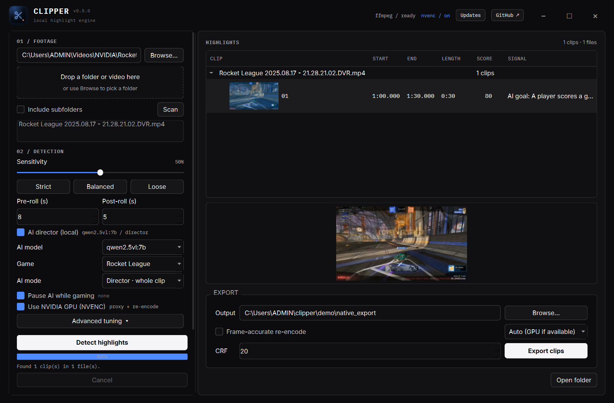
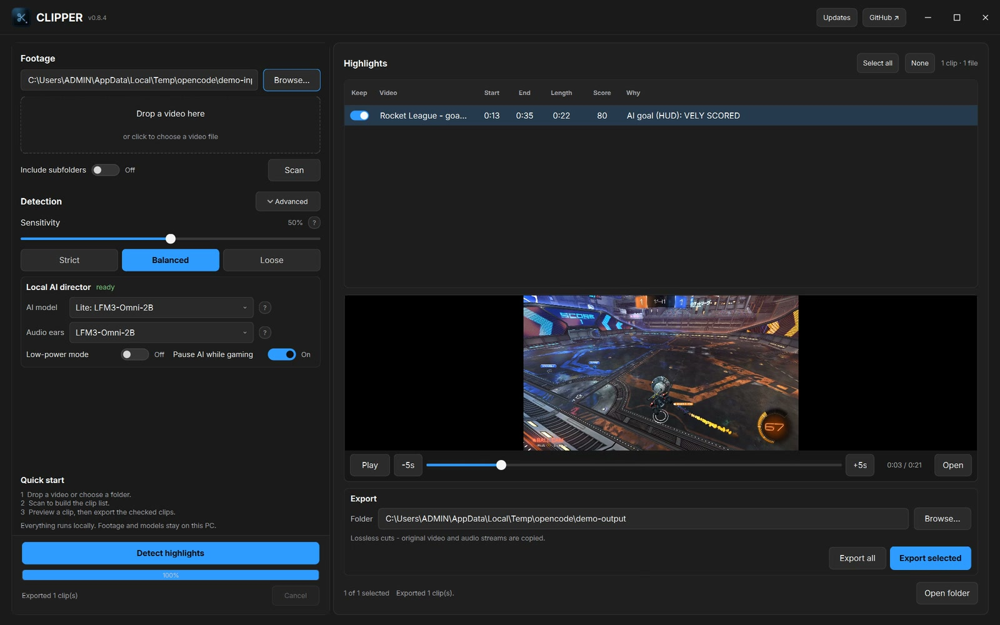

# Clipper

**Raw gameplay in. Highlights out.**

Clipper is a native Windows desktop app and Python CLI that scans a folder of gameplay, finds the loud reactions and sudden motion, merges overlapping moments, and cuts them into ready-to-post clips with FFmpeg. It runs entirely on your machine - no browser, no uploads, no accounts, no cloud. The optional AI director adds local speech transcription and whole-clip story detection.

[](https://github.com/hatermedia/clipper/actions/workflows/ci.yml)
[](LICENSE)
[](https://www.python.org/)
[](#privacy)

**Website:** [hatermedia.github.io/clipper](https://hatermedia.github.io/clipper/) · **Release:** [v0.5.0](https://github.com/hatermedia/clipper/releases/tag/v0.5.0)



[](https://github.com/hatermedia/clipper/blob/main/docs/media/demo.mp4)

*Optional web UI demo: scan → detect → export. The native app uses the same engine. Synthetic demo footage.*

---

## What it does

- **Batch a whole folder** of `.mp4`, `.mkv`, `.mov`, and `.avi` captures.
- **Audio spike detection** — short-time RMS, rolling loudness baseline, robust z-score. Finds gunfights, reactions, hype moments.
- **Visual motion detection** — samples a tiny proxy through OpenCV and scores frame deltas, hard cuts, and kill-feed flashes.
- **Hybrid excitement score** — blends both signals, rewards agreement, smooths the result, and adapts its threshold to each video.
- **Smart padding and merging** — 8s before / 5s after by default; overlapping windows merge so a continuous fight stays one clip.
- **Fast exports** — stream copy by default (`ffmpeg -c copy`), optional frame-accurate re-encode with `libx264`, `h264_nvenc`, `hevc_nvenc`, or `libx265`.
- **Native Windows app** — Qt desktop UI with a native folder picker, drag-and-drop, preview frames, progress, cancel, and export. No browser tab, no console window, no background command prompt.
- **Proper Windows installer** — per-user install, no admin prompt, Desktop/Start Menu shortcuts, and a normal uninstaller. The portable zip is still available.
- **Built-in updates** — checks GitHub Releases, shows an update bar in the app, downloads the installer, verifies its SHA-256, installs silently, and reopens.
- **Optional AI director** - transcribes the clip locally, reviews every window with frames + transcript + audio energy, and keeps the funny interactions, trolling, banter, reactions, clutch goals, and round wins. Game profiles for Rocket League, Mimesis, Valorant, Apex, and CS2. Game Guard unloads the model while you play. No cloud calls.
- **GPU + CPU controls** — GPU is enabled by default when a real one-frame NVENC test passes; NVENC handles the analysis proxy, re-encode, and the local AI runtime. CPU defaults to a balanced thread cap, with Low (2 threads), Max, and a low-power mode that lowers process priority and uses a 256px/2fps proxy.
- **Dry run** — see timestamps and preview frames before rendering anything.
- **Optional local web UI** — FastAPI + one HTML file for browser/remote use. No Node build pipeline.
- **No database, no telemetry.**

## Why another clip tool?

Most auto-clippers are built around one game, one streaming platform, or one vertical-caption workflow. Clipper is deliberately smaller and more general:

| | Clipper | Typical auto-clipper |
|---|---|---|
| Input | Any local gameplay folder | One platform / one game |
| Detection | Audio + motion + optional whole-clip AI director | Chat reactions, speech models, or cloud AI |
| Setup | Native Windows app, or Python + FFmpeg | Node, API keys, browser sessions, model downloads |
| Export | Lossless stream copy by default | Re-encode everything |
| Privacy | 100% local | Often uploads footage |
| License | MIT | Varies |

No shade to the bigger tools — they do things Clipper doesn't. Clipper is for the "I have 40GB of ShadowPlay clips and want the good 30 seconds" problem.

## Install

### Windows installer (recommended)

No Python install. No FFmpeg install. No console. No admin rights.

**[Download ClipperSetup-0.5.0.exe](https://github.com/hatermedia/clipper/releases/download/v0.5.0/ClipperSetup-0.5.0.exe)** (~155 MB)

The installer places Clipper in `%LOCALAPPDATA%\Programs\Clipper`, adds Desktop
and Start Menu shortcuts, registers an uninstaller in Windows Settings, and can
upgrade in place. It bundles Python 3.13, PySide6, FFmpeg, and FFprobe. Windows
SmartScreen may warn because the executable is unsigned; the source and
reproducible build scripts are in [`packaging/`](packaging/). SHA-256 checksums
are attached to the release as `SHA256SUMS.txt`, and the in-app updater refuses
to install a download that does not match.

Prefer a portable copy? The zip still works: unzip it and double-click
`Clipper.exe`.

**[Download clipper-0.5.0-windows-x64-native.zip](https://github.com/hatermedia/clipper/releases/download/v0.5.0/clipper-0.5.0-windows-x64-native.zip)** (~225 MB)

### Native app from source

```bash
pip install "clipper-gg[desktop]"
clipper desktop
```

`clipper` with no arguments opens the native app when PySide6 is installed.

### Requirements for source installs

- Python **3.10+**
- **FFmpeg 5+** with `ffmpeg` and `ffprobe` on `PATH`

```powershell
# Windows
winget install Gyan.FFmpeg
```

```bash
# macOS
brew install ffmpeg

# Debian / Ubuntu
sudo apt install ffmpeg
```

Verify:

```bash
ffmpeg -version
ffprobe -version
```

If FFmpeg is not on `PATH`, point Clipper at it:

```powershell
$env:CLIPPER_FFMPEG = "C:\tools\ffmpeg\bin\ffmpeg.exe"
```

### From source

```bash
git clone https://github.com/hatermedia/clipper.git
cd clipper
python -m venv .venv

# Windows
.venv\Scripts\activate

# macOS / Linux
source .venv/bin/activate

pip install -e ".[desktop]"
```

Drop `[desktop]` if you only want the CLI.

### PyPI

```bash
pip install clipper-gg
# native app extras
pip install "clipper-gg[desktop]"
# isolated CLI install
pipx install clipper-gg
```

### Release wheel (fallback)

```bash
python -m pip install https://github.com/hatermedia/clipper/releases/download/v0.5.0/clipper_gg-0.5.0-py3-none-any.whl
```

The installed command is `clipper`; the Python import is `clipper`; the PyPI distribution is `clipper-gg` (the plain `clipper` name on PyPI is an unrelated 2014 bioinformatics package).

## Quick start

```bash
# 1. Native app (installed build or `pip install "clipper-gg[desktop]"`)
clipper

# 2. See what Clipper would cut, without pinning the CPU
clipper --input "D:\Captures" --dry-run --low-power

# 3. Export the highlights. Default output: ./trimmed
clipper --input "D:\Captures" --output "D:\Highlights"

# 4. Use NVENC for the proxy/re-encode (default when available)
clipper --input "D:\Captures" --gpu --reencode --encoder auto

# 5. Let the local AI director watch the clip with audio
clipper --input "D:\Captures" --ai --ai-game Valorant --dry-run

# 6. Check for or install a newer release
clipper update
clipper update --install

# 7. Diagnose GPU/NVENC and Ollama
clipper gpu

# 8. Optional local web UI
clipper ui
```

`clipper` with no arguments opens the native app when PySide6 is installed. The
optional web UI starts at **http://127.0.0.1:8765** and binds to localhost.
Footage never leaves the machine.

## AI director (local, optional)

Audio + motion still provide timing and a fallback. With AI enabled, the
**director** watches the whole clip instead of only checking peaks:

1. Whisper transcribes the audio locally (game chat, reactions, banter, game VO).
2. The clip is split into 15–20s windows. Each window gets four frames plus its
   transcript and audio energy, and the local vision model decides whether it is
   filler, gameplay, a reaction, a clutch, or funny banter.
3. Adjacent interesting windows become one segment, so a 30–90s funny
   interaction stays together instead of being chopped into six-second peaks.
4. For conversation clips the cut is tightened to the spoken exchange; for
   gameplay it keeps the window around the event.

```bash
# One-time: install Ollama from https://ollama.com, then pull a vision model
ollama pull qwen2.5vl:7b

# Director mode is the default when AI is on
clipper --input "D:\Valorant" --ai --ai-game Valorant --dry-run
clipper --input "D:\Valorant" --ai --ai-mode review --dry-run
```

In the native app, tick **AI director (local)**, pick the model, game, and mode,
and run as usual. `ollama ps` shows whether the vision model is on the GPU.

- **Game profiles:** Rocket League, Mimesis, Valorant, Apex Legends, CS2, or
  Generic. The native app selects a preset from the footage path. Rocket League
  looks for goals/saves/passes/demos and late-night fakes; Mimesis prioritises
  screaming, trolling, betrayal, and friend banter.
- **Game Guard:** when Rocket League, Mimesis, Valorant, Apex, CS2, or another
  known game is running, Clipper pauses the director and unloads the Ollama model
  so the game gets the VRAM. It checks before analysis and between every window,
  then resumes when the game exits. `--game-guard` enables it from the CLI.
  Discord does not expose other games' Rich Presence to third-party apps, so this
  uses the local process list — the reliable signal.
- **6 GB GPUs:** the app selects `qwen2.5vl:3b` when installed on a <=7 GB card
  and uses a 4k context. It is noticeably less accurate than 7B; use 7B on 8 GB+
  for the best results.
- Default model: `qwen2.5vl:7b` (~6 GB VRAM at 8k context, 100% GPU on an RTX 3080).
- Whisper `base.en` runs on the CPU in int8: about 2.5s for a 90-second clip.
  The model is downloaded once (~145 MB) to
  `%LOCALAPPDATA%\Clipper\models\huggingface`.
- Window verdicts are cached in `%LOCALAPPDATA%\Clipper\ai-cache`; re-runs are fast.
- Director can return 4–120s segments. `--ai-mode review` keeps the older,
  faster pass that only reviews audio/motion peaks.
- Everything is local. No frames, audio, or prompts leave the machine.

**Honest limits:** this is not a trained comedy detector yet. Game voice lines
and human voice chat are mixed in the same audio track, and Whisper transcribes
both. Tactical callouts can look like banter in text, so the director also
requires a humour cue (profanity, teasing, laughter words, “bro”, etc.) before
it sells a conversation as funny. It still needs a labelled set of real funny
clips across games to tune properly. Review the results before exporting.

## Updates

The installed app checks GitHub Releases at launch (cached for six hours) and
shows an update bar when a newer version exists. **Download update** fetches the
installer, verifies it against the release's `SHA256SUMS.txt`, then changes the
button to **Restart & install**. Clipper closes, installs silently, and reopens.

```bash
clipper update            # check only
clipper update --install  # download, verify, install
```

### Dry run

```text
demo_gameplay.mp4  0:46.021  1280x720  30.0fps
  01  0:12.500 -> 0:18.500    6.0s  score 100  [audio + motion]
      preview: ...\trimmed\previews\demo_gameplay_clip01_00015500.jpg
  02  0:30.250 -> 0:36.250    6.0s  score 100  [audio + motion]
      preview: ...\trimmed\previews\demo_gameplay_clip02_00033250.jpg

Total: 2 clip(s) from 1 file(s)
Dry run: nothing rendered. Report: ...\trimmed\clipper-report-20261122-223201.json
```

Every run also writes `clipper-report-*.json` with per-file media info, clips, scores, warnings, and export results. `--json` prints the same payload to stdout for scripts.

## CLI options

| Option | Default | Description |
|---|---:|---|
| `-i, --input` | required | Folder or single video |
| `-o, --output` | `./trimmed` | Output folder |
| `--dry-run` | off | Detect + preview only; no rendering |
| `--recursive` | off | Scan subfolders |
| `--sensitivity` | `0.5` | `0..1`; higher = more clips |
| `--pre` | `8` | Seconds before each peak |
| `--post` | `5` | Seconds after each peak |
| `--min-clip` | `3` | Drop clips shorter than this |
| `--max-clips` | `30` | Cap per video |
| `--audio-weight` | `0.6` | Audio contribution |
| `--visual-weight` | `0.4` | Motion contribution |
| `--sample-fps` | `4` | Visual sampling rate (2 with `--low-power`) |
| `--proxy-width` | `320` | Analysis proxy width (256 with `--low-power`) |
| `--threads` | balanced | CPU thread cap; `0` = let FFmpeg decide |
| `--gpu` | auto | Hardware decode + NVENC proxy/re-encode when the NVENC test passes; use `--no-gpu` to force CPU |
| `--low-power` | off | 2 threads, 2fps/256px proxy, below-normal priority |
| `--ai` | off | Use the local AI director (Ollama + local Whisper) |
| `--ai-model` | `qwen2.5vl:7b` | Ollama vision model |
| `--ai-game` | `generic` | Game context for the prompt, e.g. `Valorant` |
| `--ai-mode` | `director` | `director` watches the whole clip; `review` checks peaks only |
| `--game-guard` | off | Pause AI and unload the model while a known game is running |
| `--ai-min-confidence` | `0.55` | Minimum model confidence to keep a candidate |
| `--ai-max-candidates` | `60` | Cap on windows sent to the vision model |
| `--merge-gap` | `1.0` | Merge clips closer than this |
| `--reencode` | off | Frame-accurate encode instead of copy |
| `--encoder` | `auto` | `auto`, `libx264`, `h264_nvenc`, `hevc_nvenc`, `libx265` |
| `--crf` | `20` | Quality for re-encode |
| `--preset` | `veryfast` | x264/x265 preset |
| `--no-previews` | off | Skip dry-run thumbnails |
| `--json` | off | Machine-readable output |
| `--quiet` | off | Suppress progress |

Subcommands `batch`, `run`, `trim`, and `detect` are accepted as aliases for the default batch mode.

## How detection works

Clipper is a heuristic engine first, with an optional local semantic review pass. That is intentional: predictable behavior, no cloud dependency, and it works on any game. GPU acceleration covers decode, proxy encode, re-encode, and the optional AI runtime; motion scoring and audio RMS stay on the CPU.

### 1. Audio spikes

- Extract mono 16 kHz PCM with FFmpeg.
- Compute RMS in 50 ms windows.
- Compare each window to a **4-second rolling median** baseline.
- Convert the excess into a robust z-score; blend with absolute loudness.
- Normalize by the 99th percentile and smooth over ~0.6s.

A quiet tactical stretch with one loud reload will score differently from a constant-loud gunfight, which is what you want.

### 2. Visual activity

- Build a temporary **320px-wide, 4fps proxy** with FFmpeg (configurable; 256px/2fps in low-power mode).
- Read it with OpenCV, with its thread count capped.
- Per frame: grayscale, blur, absolute difference against the previous frame.
- Score = mean difference + 90th-percentile difference + brightness flash.
- Normalize with a p95 scale plus percentile rank, so both sustained motion and one-frame flashes register.

The proxy keeps analysis fast on 1440p/4K footage and avoids decoding every frame at full resolution.

### 3. Fusion and window selection

- Resample both tracks onto a 0.25s grid.
- Weighted blend (default 60% audio / 40% motion) with a small agreement bonus.
- Smooth, then pick peaks with an **adaptive threshold** (`99.5 - 9 × sensitivity` percentile), minimum 4s spacing, and prominence filtering.
- Pad each peak by `--pre` / `--post`.
- Merge overlapping or near-overlapping windows.
- Clamp to the video, drop clips under `--min-clip`, cap at `--max-clips`, sort chronologically.

### Tuning

| Preset | Sensitivity | Pre | Post | Best for |
|---|---:|---:|---:|---|
| Strict | `0.30` | `10` | `6` | Only the biggest moments |
| Balanced | `0.50` | `8` | `5` | Default |
| Loose | `0.75` | `6` | `4` | Fast-paced montages |

- **Too many clips?** Lower sensitivity, raise `--min-clip`, or raise the audio weight.
- **Missing quiet moments?** Raise sensitivity or raise `--visual-weight` (e.g. `0.7`) for flick-heavy games.
- **Clips cut off too early?** Increase `--post`.
- **Continuous fights split in two?** Increase `--merge-gap` or `--pre`/`--post`.

## Lossless vs frame-accurate

By default Clipper uses **stream copy**:

```bash
ffmpeg -ss START -i input.mp4 -t DURATION -map 0:v:0 -map 0:a:0? -c copy output.mp4
```

This is effectively instant and does not touch quality. The trade-off: copy can only start on a keyframe, so a clip may include a little extra footage before the requested timestamp. That is usually fine for highlights — you get the moment plus a bit of run-up.

Use `--reencode` when the edges matter:

```bash
clipper --input ./footage --reencode --encoder auto
clipper --input ./footage --reencode --encoder libx264 --crf 20
clipper --input ./footage --gpu --reencode --encoder h264_nvenc
```

- `auto`: NVENC when available, otherwise libx264.
- `libx264` / `libx265`: CPU, predictable, works everywhere.
- `h264_nvenc` / `hevc_nvenc`: NVIDIA GPU. If the encoder is listed but unusable (driver/GPU mismatch), Clipper automatically retries with `libx264`.
- Re-encoded output is always `.mp4` (H.264/HEVC + AAC).

## Native desktop app

The Windows portable zip ships `Clipper.exe` — a windowed Qt app with:

- Native folder picker and drag-and-drop.
- Sensitivity, padding, max clips, sample FPS, and proxy width.
- GPU/NVENC toggle, CPU thread cap (Balanced / Low / Max), and low-power mode.
- Results table with peak-frame previews.
- Re-encode toggle, encoder picker, CRF, export progress, and “Open output folder”.
- No browser, no console window, no background command prompt.

From source:

```bash
pip install "clipper-gg[desktop]"
clipper desktop
```

## Optional web UI

```bash
clipper ui
# custom port / no browser tab
clipper ui --port 9000 --no-browser
# expose to your LAN (only if you understand the risk)
clipper ui --host 0.0.0.0
```

The UI includes:

- Folder browser with drives, parent navigation, and single-file selection.
- Sensitivity slider + Strict/Balanced/Loose presets.
- Pre/post padding, max clips, sample FPS, audio/motion weights.
- Per-file clip list with preview thumbnails and score breakdown.
- Export panel with output path, re-encode toggle, encoder picker, live progress, cancel.
- Local-only FastAPI backend; the frontend is one static HTML file (Tailwind + Alpine via CDN).

### API

| Method | Path | Purpose |
|---|---|---|
| `GET` | `/api/health` | FFmpeg status, version, NVENC availability |
| `GET` | `/api/browse?path=` | Folder browser |
| `POST` | `/api/scan` | List supported videos |
| `POST` | `/api/analyze` | Start a background detection job |
| `GET` | `/api/jobs/{id}` | Poll job progress/result |
| `POST` | `/api/jobs/{id}/cancel` | Cancel analysis/export |
| `POST` | `/api/export` | Export a stored analysis |
| `GET` | `/api/thumb?file=&t=&w=` | Cached preview frame |
| `GET` | `/api/docs` | OpenAPI UI |

## Docker

```bash
docker build -t clipper .
docker run --rm -it \
  -p 127.0.0.1:8765:8765 \
  -v "/path/to/footage:/footage" \
  -v "/path/to/clips:/out" \
  clipper ui --host 0.0.0.0 --port 8765
```

Inside the container, use `/footage` in the UI. Batch mode:

```bash
docker run --rm \
  -v "/path/to/footage:/footage" \
  -v "/path/to/clips:/out" \
  clipper --input /footage --output /out
```

The image runs as a non-root user. If your mounted folders are not writable, adjust permissions or pass `--user "$(id -u):$(id -g)"` on Linux.

## Performance notes

- Analysis is one audio pass + one proxy pass + OpenCV scanning. The proxy is 320px at 4fps by default; `--proxy-width` and `--sample-fps` change it. A 46-second 720p clip takes a few seconds here; 4K and long VODs take longer.
- **The default CPU behavior is balanced, not “all cores.”** Threads default to about half the logical cores. Use `--threads 2`, `--low-power`, or the native app’s Low setting to keep the machine usable while gaming/streaming. Use `--threads 0` or Max only when you want the whole CPU.
- **GPU:** enabled by default when a **real one-frame NVENC test** passes, not merely because the encoder is listed. It handles the proxy and `--encoder auto` re-encode. If NVENC is listed but unusable, Clipper falls back to libx264 and reports it. `clipper gpu` prints the test result and `nvidia-smi` summary. OpenCV motion scoring and audio RMS remain CPU work; decode may still be CPU-bound depending on the codec.
- Stream-copy export is nearly instant and uses almost no CPU.
- Re-encoding is the slow path. `h264_nvenc` is much faster than `libx264` when it works.
- Preview thumbnails are cached by file mtime + timestamp in the OS temp folder.

## Supported formats

Input containers: `.mp4`, `.mkv`, `.mov`, `.avi`. If FFmpeg can decode it, Clipper can usually analyze it. Output keeps the source container for lossless copy, or uses `.mp4` for re-encode. HDR/10-bit footage is best re-encoded to SDR H.264 for sharing.

## Troubleshooting

| Problem | Fix |
|---|---|
| `ffmpeg/ffprobe not found` | Install FFmpeg or set `CLIPPER_FFMPEG` to the executable |
| `No supported video files found` | Check the folder, extension, and `--recursive` |
| No clips detected | Raise `--sensitivity`, check the audio track, or raise `--visual-weight` |
| Clips start a second early | Expected with stream copy; use `--reencode` |
| Export says “re-encoded because stream copy was not compatible” | Container/codec mismatch; this is automatic and safe |
| NVENC fails at runtime | Run `clipper gpu`; update GPU drivers; Clipper falls back to `libx264` |
| CPU is pinned during analysis | Use `--low-power`, `--threads 2`, a lower `--sample-fps`/`--proxy-width`, or the native app's Low-power toggle |
| GPU toggle shows CPU mode | Run `clipper gpu`; the NVENC test failed or the FFmpeg build lacks NVENC. CPU still works |
| Native app says PySide6 missing | `pip install "clipper-gg[desktop]"` or use the Windows portable build |
| UI says FFmpeg missing | Restart the terminal after installing FFmpeg, then restart `clipper ui` |
| Very long Windows paths fail | Enable Win32 long paths or use a shorter output path |
| Web UI port busy | `clipper ui --port 9000` |

## Development

```bash
git clone https://github.com/hatermedia/clipper.git
cd clipper
python -m venv .venv
.venv\Scripts\activate        # Windows
pip install -e ".[dev,desktop]"

pytest -q
```

End-to-end test (generates a synthetic 46s clip with known action windows):

```powershell
$env:CLIPPER_E2E = "1"
pytest -q tests/test_e2e.py
```

Generate demo footage manually:

```bash
python scripts/make_demo_video.py --output demo/demo_gameplay.mp4
```

Project layout:

```text
src/clipper/
  cli.py            argparse CLI, dry-run report, export
  desktop.py        native PySide6 app (folder picker, GPU/CPU controls)
  assets/           app icon and desktop assets
  ffmpeg.py         probe / PCM / proxy / thumbnail / render
  pipeline.py       scan → analyze → export
  detect/audio.py   RMS spike scoring
  detect/visual.py  OpenCV motion scoring
  detect/merge.py   fusion, peak picking, window merging
  web/app.py        optional FastAPI API + job manager
  web/static/       optional single-page web UI
tests/              unit + API + desktop smoke + gated end-to-end
scripts/            synthetic footage generator
packaging/          Windows native/CLI build scripts
```

## Roadmap

- Manual clip editor with waveform + timeline scrub.
- Scene-cut-aware lossless splitting.
- Per-game presets (Apex, Valorant, CS2, Fortnite, racing).
- Vertical crop + captions (9:16) as an optional second stage.
- Full GPU motion scoring (OpenCV scoring is CPU today; NVENC covers decode/encode).
- Whisper-based reaction/speech cues as an optional third detector.
- Twitch/YouTube VOD import (explicitly opt-in, local download).
- Drag-and-drop UI for individual clips.

## Done-for-you clips (optional)

If you want the output without the setup, there are limited pilot slots for
trimmed clip packs. You keep the rights; the tool stays free and MIT licensed.
See [SERVICE.md](SERVICE.md) for packages, process, and terms. This is separate
from the open-source project and does not affect the free release.

## Contributing

Issues and PRs are welcome. Please include:

- OS + Python version + `ffmpeg -version`.
- The command you ran.
- A short description of the footage (resolution, fps, codec, audio).
- If detection missed, the timestamps you expected.

Do not upload copyrighted gameplay you don't own. A synthetic reproduction or a short, rights-cleared sample is enough.

## License

MIT — see [LICENSE](LICENSE).

Clipper is not affiliated with Twitch, YouTube, NVIDIA, or any game publisher. You are responsible for the footage you process and publish.
