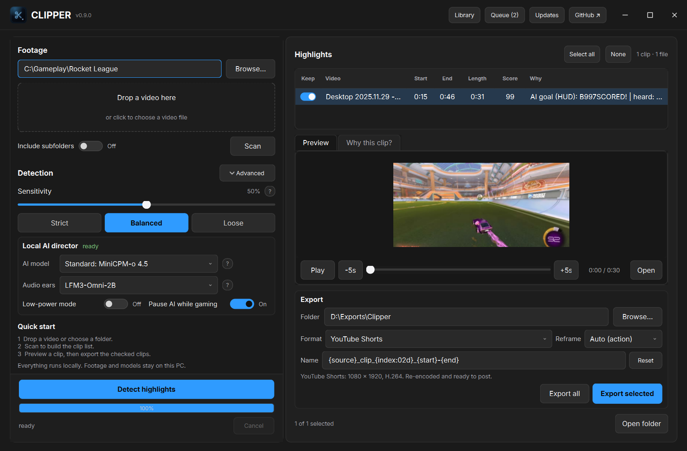
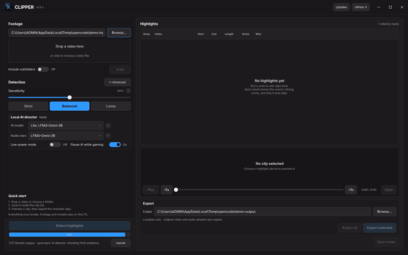

# Clipper

Clipper is a native Windows app that scans a folder of gameplay, uses a local
vision director with transcript, HUD, and audio signals to find the story beats,
and cuts ready-to-post clips with FFmpeg. Everything runs locally. No accounts,
no uploads, no browser.





*Workflow demo: select footage, detect highlights, preview, and export. [Watch the full MP4](https://raw.githubusercontent.com/hatermedia/clipper/main/docs/media/demo.mp4).*

**Website:** [hatermedia.github.io/clipper](https://hatermedia.github.io/clipper/) | **Latest release:** [v0.9.0](https://github.com/hatermedia/clipper/releases/tag/v0.9.0)

## Install

**Windows 10/11 installer (recommended):** [Download ClipperSetup-0.9.0.exe](https://github.com/hatermedia/clipper/releases/download/v0.9.0/ClipperSetup-0.9.0.exe)

- Per-user install, no admin prompt
- Installs to `%LOCALAPPDATA%\Programs\Clipper`
- Desktop and Start Menu shortcuts
- Built-in SHA-256 verified updates
- Uninstall removes the app and settings, not your footage, exports, models, or
  runtime

The installer is about 380 MiB. It includes FFmpeg, Whisper `base.en`, RapidOCR,
YAMNet, and the runtime they need. The installed app is about 1.05 GB (1.0 GiB),
including the 145 MB Whisper model. The installer is compressed per file, so an
upgrade does not wait behind one solid compression block.

A multi-gigabyte vision model is **not** bundled. Clipper downloads its own
llama.cpp runtime and a model only when you ask for them from the AI panel:

- Lite: LFM3-Omni-2B, 2.05 GB download / 1.91 GiB on disk
- Standard: MiniCPM-o 4.5, 6.12 GB download / 5.70 GiB on disk
- Google: Gemma 4 12B, 7.56 GB download / 7.04 GiB on disk

The llama.cpp runtime is a separate download of 749 MB (715 MiB), and about
1.41 GB (1.31 GiB) when installed. Runtime and models live under
`%LOCALAPPDATA%\Clipper` and survive app upgrades.

Running a newer installer over an older install reuses the same per-user folder
and overwrites it in place. It does not create a second Clipper installation.

Prefer a portable copy? [Download the native zip](https://github.com/hatermedia/clipper/releases/download/v0.9.0/clipper-0.9.0-windows-x64-native.zip)
and run `Clipper.exe`. Both packages include `BUILD_INFO.txt` with the version,
full build commit, build date, platform, and tool versions; `Clipper.exe`
reports 0.9.0 file and product versions in Windows Explorer.

### Requirements

- Windows 10 or Windows 11, 64-bit
- About 1 GB free disk for the app before AI setup
- Internet access for the first AI runtime/model download and update checks
- No administrator rights, Python, FFmpeg, Ollama, Visual C++ Redistributable,
  or CUDA Toolkit install

An NVIDIA GPU is optional but recommended. The bundled llama.cpp runtime is a
CUDA 12.4 build and needs an NVIDIA Windows driver version 551.61 or newer. No
CUDA Toolkit is needed. The runtime includes its own CUDA user-mode DLLs.
NVENC/NVDEC are used when the driver and GPU support them; otherwise FFmpeg uses
CPU encoding. AMD and Intel GPUs can run the app, but the bundled AI runtime and
Clipper's GPU/NVENC path are NVIDIA/CUDA-focused.

CPU-only AI is supported as a fallback and is much slower. OpenCV motion
scoring and audio analysis already run on the CPU; the GPU is used for
decode/encode and the AI models.

Approximate total disk use after setup:

- Lite only: about 4.5 GB (4.2 GiB)
- Standard plus LFM3 audio ears: about 10.6 GB (9.9 GiB)
- Google plus LFM3 audio ears: about 12.1 GB (11.2 GiB)

Leave extra space for the analysis proxy, temporary audio, preview frames, and
exports. Long source videos can need several gigabytes of working space.

## What it does

- **Smart padding and merging** - every detected peak gets 8 seconds before and
  5 seconds after. Windows merge when they overlap or are less than a second
  apart, keeping the stronger peak. A fight stays one clip instead of six
  fragments.
- **Flat highlight list** - every clip is one row with its source video, time
  range, score, and grounded reason. No nested video groups.
- **Inline preview player** - selecting a row shows its peak frame and stays
  paused. Play, pause, seek, and -5s/+5s controls are in the preview panel. A
  single click never starts playback; double-click is a shortcut to play.
- **Local AI only** - every scan is reviewed by the local vision director.
  There is no heuristic-only highlighting mode.
- **Game Guard** - pauses AI and frees VRAM while a game is running, then
  resumes automatically. It uses a large title map, Unreal Engine process
  detection, and major game-library paths.
- **Lossless cuts** - stream copy keeps the original video and audio and exports
  almost instantly.
- **GPU + CPU controls** - real NVENC test, balanced thread cap, and a low-power
  preset.

## Workflow features

Clipper 0.9 adds the post-detection workflow:

- **Clip library** - reopen previous scans and keep keep/reject decisions,
  notes, tags, evidence, and export history. Stored locally under
  `%LOCALAPPDATA%\Clipper\library`.
- **Creator presets** - YouTube Shorts, TikTok, Reels, square, landscape, H.264,
  HEVC, batch export, and filename templates.
- **Automatic vertical reframe** - action or facecam tracking with a smoothed
  crop path, plus a center fallback.
- **Why this clip?** - transcript, HUD proof, audio signals, reviewed windows,
  and model confidence for every clip.
- **Watch folders and queue** - baseline a folder, queue new recordings, wait for
  idle time or game exit, pause, resume, and recover after a crash.

See [docs/WORKFLOW_0.9.md](docs/WORKFLOW_0.9.md) for behavior, storage, CLI
examples, and current limitations, or the
[0.9.0 release notes](docs/RELEASE_NOTES_v0.9.0.md) for the feature summary.

## First run and local AI

Clipper is AI-first. Every scan is reviewed by a local vision director that
watches the full clip in short windows, transcribes the audio with Whisper, and
uses HUD/audio signals to find the story beats. There is no heuristic-only
highlighting fallback.

The AI model is required for Detect highlights, but it is not bundled. To set it
up:

1. Open the **AI model** dropdown in the Local AI director panel.
2. Choose a bundled tier: **Lite**, **Standard**, or **Google**.
3. Click **Download**. Clipper installs the llama.cpp runtime first, then the
   selected model, with progress shown in the panel.
4. Wait for the model to become ready, then click **Detect highlights**.

The picker shows the download size next to each tier. Installed models do not
show a download tag. The runtime and models are stored in:

- `%LOCALAPPDATA%\Clipper\ai-runtime\llama-b12776`
- `%LOCALAPPDATA%\Clipper\ai-models\<model-id>`

Audio ears are optional. They use LFM3-Omni-2B. If the vision model is LFM3, the
same model handles vision and audio. If the vision model is MiniCPM or Gemma,
Clipper downloads LFM3 separately for the ears pass. You can turn audio ears off
in the AI panel.

The AI model dropdown also offers **Connect local server...**. It accepts an
OpenAI-compatible base URL, reads `/v1/models`, and lets you add exactly one
model. That model must accept image input and return JSON. No API key is sent.
This is optional and works with LM Studio, llama.cpp server, vLLM, Jan, and
similar local endpoints.

Ollama is not required. Clipper does not install it. It remains an optional
alternative backend for the CLI and existing configurations, and for models
that need Ollama-specific audio support. The normal first-run path is the
bundled llama.cpp runtime and one of the three bundled model tiers.

### VRAM guidance

The model picker shows conservative planning targets:

- Lite LFM3: about 4 GB VRAM
- Standard MiniCPM: about 8.5 GB VRAM
- Google Gemma: about 10.5 GB VRAM

These are not exact consumption figures. On the test machine (RTX 3080 10 GB,
driver 610.88, 8192 context for LFM3 and 4096 for the larger models), measured
model load was about 2.9 GiB above idle for LFM3, 6.4 GiB for MiniCPM, and
7.8 GiB for Gemma. Add about 2.9 GiB if LFM3 audio ears run at the same time as
a different vision model.

Clipper checks the selected NVIDIA GPU immediately before each model start and
again between the vision, ears, and final-edit stages. It uses total, used, and
free VRAM, not just the card's advertised capacity, so games, OBS, browser
hardware acceleration, and other GPU workloads affect the decision. The model
decision subtracts the measured model allocation and a 1 GiB reserve from live
free memory. It respects `CUDA_VISIBLE_DEVICES` and follows the GPU that
llama.cpp will use.

On a 10 GB card, Clipper automatically keeps only one model resident when the
selected vision model and LFM3 ears do not fit with 1 GB of headroom. Direct
dual residency on the 10 GB test card peaked at 9,733 MiB of 10,240 MiB, leaving
only about 0.5 GiB, so the guard is enabled for this pair. With a clean desktop,
the live check reports about 9,140 MiB free: 9,600 MiB for both models plus the
1,024 MiB reserve does not fit. It unloads the vision model before the ears
pass and reloads it for the final edit. With the guard, a real 35-second scan
peaked at 7,396 MiB and only one model was resident. This is slower because each
video pays the model load cost again.

If another application is using the GPU, the same rule applies to live free
memory. A 3 GiB external allocation left 6,037 MiB free: MiniCPM alone did not
fit and was refused with a clear message, while LFM3 alone loaded and completed
the scan. If GPU memory telemetry is unavailable, Clipper does not treat the
memory as sufficient; it uses sequential inference and conservative checks. If
a model start still hits CUDA out-of-memory, Clipper stops the failed process,
waits for its allocation to be released, retries once, then reports the error.

Practical minimum and recommended VRAM:

- Lite: 4 GB minimum, 6 GB recommended.
- Standard: 8.5 GB minimum, 10 GB recommended.
- Google: 10 GB works with little headroom, 12 GB recommended.

Low-power mode forces the same one-at-a-time swap and also lowers threads and
proxy resolution. On 8 GB or less, Lite is the safe choice. CPU-only fallback
works but is much slower.

### Low-power mode

Low-power mode is a performance preset, not a separate product:

- 2 CPU threads
- 256 px wide, 2 fps analysis proxy
- Below-normal process priority
- At most one AI model resident at a time when vision and ears differ
- Systems with low or busy VRAM serialize automatically even when this is off

The local AI director still runs. Low-power mode only trades speed for lower
resource use; it never turns highlighting off.

## Game Guard

Game Guard looks at local processes and paths. It covers a large built-in title
list, generic Unreal Engine shipping
processes, and games installed through Steam, Epic, GOG, Riot, EA, Ubisoft, and
Xbox paths. You can add private or missed titles in
`%LOCALAPPDATA%\Clipper\games.json`:

```json
{
  "mygame.exe": "My Game"
}
```

When a known game is running, Clipper pauses the director and releases model
VRAM. It resumes when the game closes.

## Privacy

Footage never leaves the machine. Analysis, OCR, transcription, and export are
local. Clipper has no accounts and no telemetry. The 0.9 clip library and scan
queue are local data under `%LOCALAPPDATA%\Clipper`; they store paths, notes,
tags, evidence text, and preview JPGs, not copies of the source video. Network
access is limited to the optional GitHub update check, the AI runtime and model
downloads when you request them, and the local server URL you configure. Local server requests go
to the endpoint you enter, normally on your machine or local network. Clipper
does not send an API key. Release downloads use HTTPS and are checked against
SHA-256 hashes.

## Troubleshooting

The full troubleshooting guide is in `README.txt` inside the installer and in
the portable zip. Common points:

- **SmartScreen warning:** the build is unsigned. Use "More info" then "Run
  anyway" only for a file downloaded from the official release page.
- **AI download fails:** check internet, VPN/proxy, firewall, and free disk.
  Partial downloads resume; runtime and model files are SHA-256 verified.
- **Model does not start:** check
  `%LOCALAPPDATA%\Clipper\ai-models\<model-id>\server.log`, update the NVIDIA
  driver to 551.61 or newer, close GPU-heavy apps, and try Lite or Low-power
  mode.
- **No supported vision model installed:** download a bundled tier or connect
  a local OpenAI-compatible server.
- **Local server fails:** use a base URL such as `http://127.0.0.1:1234`; the
  server must expose `/v1/models` and accept image input with JSON responses.
  Clipper does not send an API key.
- **Uninstall:** removes the app and settings, not footage, exports, models, or
  the llama.cpp runtime. Delete `%LOCALAPPDATA%\Clipper\ai-models` and
  `%LOCALAPPDATA%\Clipper\ai-runtime` manually to reclaim that space.

## Build from source

For development only:

```powershell
git clone https://github.com/hatermedia/clipper.git
cd clipper
py -m venv .venv
.\.venv\Scripts\pip install -e ".[desktop]"
.\.venv\Scripts\python -m clipper.desktop
```

Packaging scripts and checksums live in `packaging/`. Third-party notices and
license texts are in `THIRD_PARTY_NOTICES.txt`, `packaging/FFMPEG_NOTICE.txt`,
and `packaging/licenses/`.

## License

MIT. See [LICENSE](LICENSE). You are responsible for the rights to the footage
you process.
