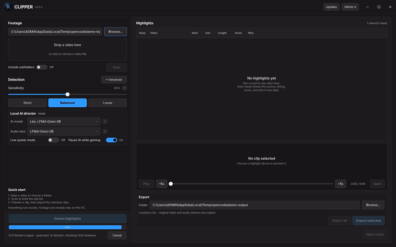

# Clipper v0.1.1

Windows portable build, public landing page, and a lower-friction download path.



**SHA-256 checksums:** [SHA256SUMS.txt](https://github.com/hatermedia/clipper/releases/download/v0.1.1/SHA256SUMS.txt)

## Highlights

- **Windows x64 portable zip** — bundles Python 3.13, FFmpeg, FFprobe, the local
  web UI, and CLI launchers. Unzip, double-click `Clipper UI.cmd`, pick a folder.
  No Python or FFmpeg install required.
- **Frozen-build FFmpeg discovery** — the executable looks in its own folder,
  `bin/`, and `ffmpeg/bin/` before falling back to `PATH`.
- **Public site** — [hatermedia.github.io/clipper](https://hatermedia.github.io/clipper/)
  with a 20-second real UI demo, install paths, guides, and an optional
  done-for-you clip service.
- **Demo assets** — `docs/media/demo.mp4` (19.5s, 630 KB) and `demo.gif` (3.7 MB),
  recorded from the actual UI doing scan → detect → export.
- **Guides** — batch ShadowPlay trimming, automatic highlight detection, and an
  honest open-source comparison.
- **Service pilot** — a separate, optional done-for-you clip pack. The software
  stays free and MIT licensed. Terms: [SERVICE.md](https://github.com/hatermedia/clipper/blob/main/SERVICE.md).

## Install

### Windows (recommended)

Download and unzip:

**[clipper-0.1.1-windows-x64-portable.zip](https://github.com/hatermedia/clipper/releases/download/v0.1.1/clipper-0.1.1-windows-x64-portable.zip)** (188 MB)

Then run `Clipper UI.cmd`.

### Source / macOS / Linux

Requires Python 3.10+ and FFmpeg on `PATH`.

```bash
python -m pip install https://github.com/hatermedia/clipper/releases/download/v0.1.1/clipper_gg-0.1.1-py3-none-any.whl
clipper --input "D:\Captures" --dry-run
clipper ui
```

Or:

```bash
pipx install git+https://github.com/hatermedia/clipper.git
```

## Verification

- Unit/API suite and the synthetic end-to-end pipeline pass on Windows.
- GitHub Actions passes the Linux test matrix (3.10 / 3.12 / 3.13) and E2E job.
- Portable `clipper.exe` verified with bundled FFmpeg: dry-run detected both
  known action windows and exported previews; the local UI health endpoint
  returned 200.
- Bio: no uploads, no accounts, no telemetry.

## Known limitations

- Stream-copy clips can start on the previous keyframe; use `--reencode` for
  exact edges.
- The detector is heuristic: loud + fast-moving, not semantic game understanding.
- No vertical crop or captions yet.
- The portable build is Windows x64 only; macOS/Linux use the wheel or source.
- Windows SmartScreen may warn because the executable is unsigned. The source
  and reproducible build script are public.
- PyPI publication of `clipper-gg` is still pending a PyPI API token. The release
  wheel and portable build work today.

## Feedback

Open an issue with OS, FFmpeg version, command, footage details, and the
timestamps you expected. Detection misses in specific games are especially
useful.
