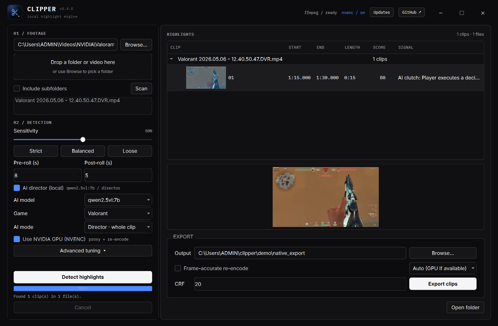

# Clipper v0.2.0

The native desktop release.



**SHA-256 checksums:** [SHA256SUMS.txt](https://github.com/hatermedia/clipper/releases/download/v0.2.0/SHA256SUMS.txt)

## Highlights

- **Native Windows app** - `Clipper.exe`, a windowed PySide6/Qt application with
  a native folder picker and drag-and-drop. No browser tab, no console window,
  no background command prompt.
- **GPU + CPU controls** - NVENC for the analysis proxy and optional re-encode,
  a balanced half-core default, Low (2 threads), Max, and a low-power mode
  (2 threads, 256px/2fps proxy, below-normal process priority).
- **In-app workflow** - sensitivity and padding, advanced tuning, progress,
  cancel, result rows with peak-frame previews, re-encode/CRF, export, and
  “Open output folder”.
- **CLI hardware flags** - `--threads`, `--proxy-width`, `--gpu`, `--low-power`,
  and `--encoder auto`.
- **Optional web UI** - `clipper ui` remains available for browser/remote use.
  The native app uses the same engine.

## Install

### Windows native app

**[clipper-0.2.0-windows-x64-native.zip](https://github.com/hatermedia/clipper/releases/download/v0.2.0/clipper-0.2.0-windows-x64-native.zip)** (225 MB)

Unzip and double-click `Clipper.exe`. Python, PySide6, FFmpeg, and FFprobe are
bundled. Windows SmartScreen may warn because the executable is unsigned; the
source and build script are public.

### CLI / macOS / Linux

Requires Python 3.10+ and FFmpeg on `PATH`.

```bash
python -m pip install https://github.com/hatermedia/clipper/releases/download/v0.2.0/clipper_gg-0.2.0-py3-none-any.whl
clipper --input "D:\Captures" --dry-run --low-power
clipper --input "D:\Captures" --output "D:\Highlights" --gpu
```

Native app from source:

```bash
pip install "clipper-gg[desktop]"
clipper desktop
```

`clipper` with no arguments opens the native app when PySide6 is installed.

## Verification

- Native `Clipper.exe` smoke test exits 0; the populated results view was
  captured from the frozen executable after a real analysis/export.
- CLI tests, API tests, desktop smoke test, and synthetic E2E pass.
- GitHub Actions runs the Linux test matrix and E2E job.
- Web UI remains functional; the native app is the primary Windows path.

## Known limitations

- GPU acceleration covers NVENC encoding and an attempted hardware-decode
  proxy; decoding may still use the CPU depending on the codec.
- Stream-copy clips can start on the previous keyframe; use re-encode for exact
  edges.
- The detector is heuristic: loud + fast-moving, not semantic game understanding.
- No vertical crop or captions yet.
- Portable build is Windows x64; macOS/Linux use the wheel/source and CLI.
- PyPI publication of `clipper-gg` is still pending a valid API token. The
  GitHub release assets work today.

## Feedback

Open an issue with your OS, GPU, FFmpeg version, command/settings, footage
details, and expected timestamps. Detection misses and CPU/GPU behavior are the
most useful reports.
