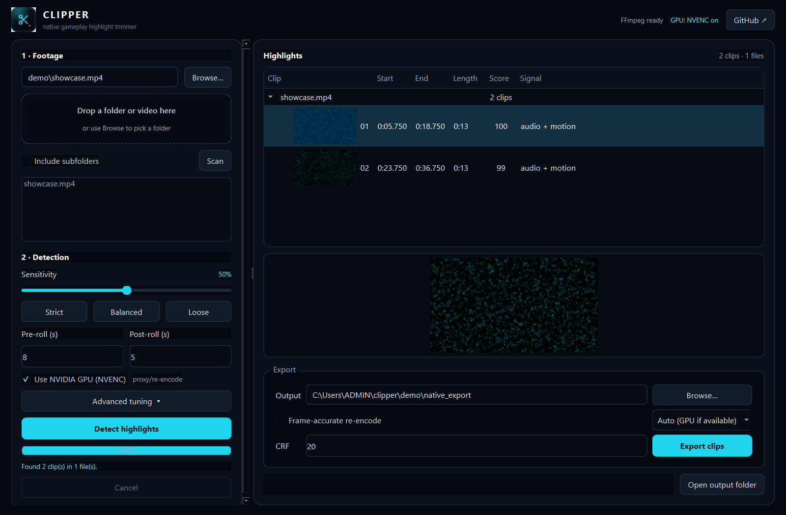

# Clipper v0.2.1

GPU detection fix for the native app.



**SHA-256 checksums:** [SHA256SUMS.txt](https://github.com/hatermedia/clipper/releases/download/v0.2.1/SHA256SUMS.txt)

## Why this release exists

v0.2.0 could report “GPU: NVENC” while the GPU toggle was off, and the new
capability probe mistakenly used a 128×128 test frame. NVIDIA rejects that as
below its minimum supported dimension, so a perfectly working RTX 3080 was
reported as unavailable and the pipeline stayed on CPU.

## Fixed

- The NVENC probe now uses a valid 256×144 frame and performs a real one-frame
  encode instead of trusting `ffmpeg -encoders`.
- **GPU is enabled by default in the native app and CLI when the probe passes.**
  `--no-gpu` forces CPU; `--gpu` asks for GPU explicitly.
- Analysis progress reports the actual proxy backend: `NVENC`,
  `NVENC + hardware decode`, or a CPU fallback.
- If a GPU proxy request falls back to CPU, the result carries a visible warning.
- Added `clipper gpu` diagnostics: NVENC test result, `nvidia-smi` summary, and
  a clear note about what is GPU-accelerated and what is not.

## Important: what still uses CPU

NVENC covers the tiny analysis proxy and optional re-encode. **OpenCV motion
scoring and audio RMS analysis remain CPU work.** Streaming a 4K source may also
use CPU for decode/filters depending on the codec. Use `--low-power`,
`--threads 2`, or the native app’s Low-power toggle if the machine is also
gaming/streaming.

## Install

### Windows native app

**[clipper-0.2.1-windows-x64-native.zip](https://github.com/hatermedia/clipper/releases/download/v0.2.1/clipper-0.2.1-windows-x64-native.zip)** (225 MB)

Unzip, double-click `Clipper.exe`. Python, PySide6, FFmpeg, and FFprobe are
bundled. The GPU checkbox should be checked and the header should read
`GPU: NVENC on` on an NVIDIA machine where the test passes.

### CLI

```bash
python -m pip install https://github.com/hatermedia/clipper/releases/download/v0.2.1/clipper_gg-0.2.1-py3-none-any.whl
clipper gpu
clipper --input "D:\Captures" --dry-run
```

## Verification

- `clipper gpu` on the RTX 3080: `NVENC H.264 test encode: PASS`.
- Native frozen `Clipper.exe`: GPU checkbox on by default, analysis produced 2
  clips, native export produced 2 files.
- Unit/API/desktop tests pass.
- CI runs the Linux matrix and E2E job.

## Known limitations

- No full-GPU motion scoring yet; OpenCV runs on CPU.
- Stream copy can start on the previous keyframe; use re-encode for exact edges.
- Vertical crop/captions are not included.
- PyPI publication is still pending a valid API token; GitHub release assets
  work today.
